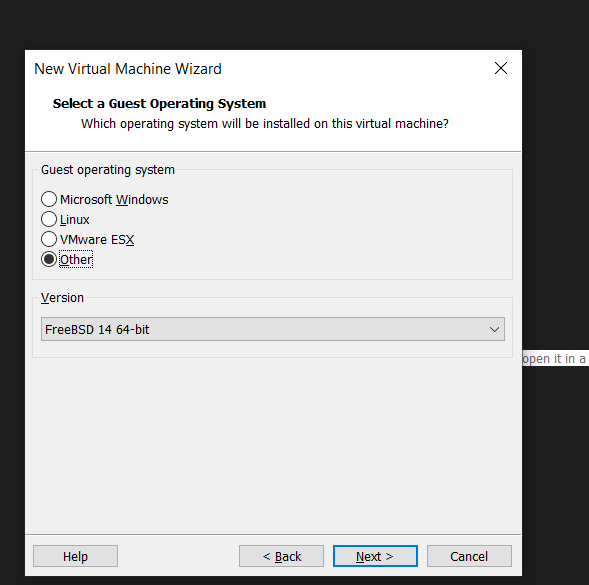
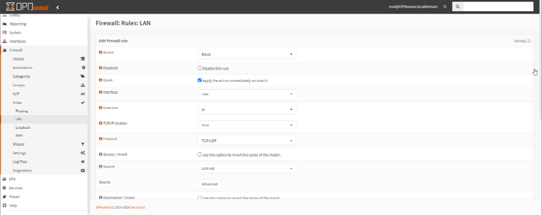
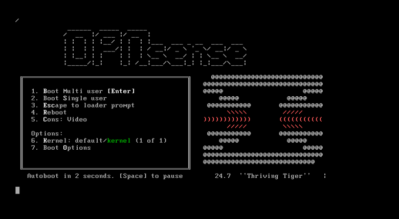
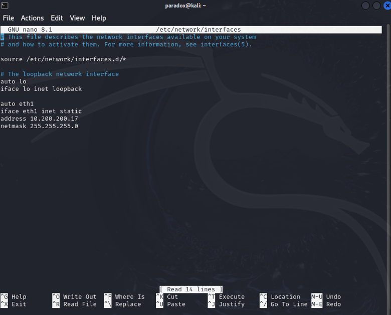
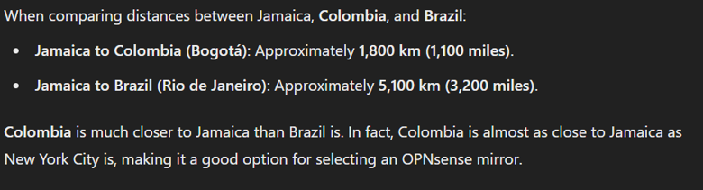
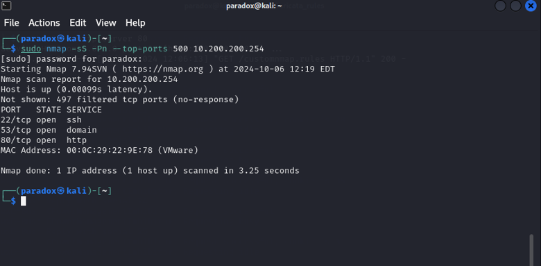
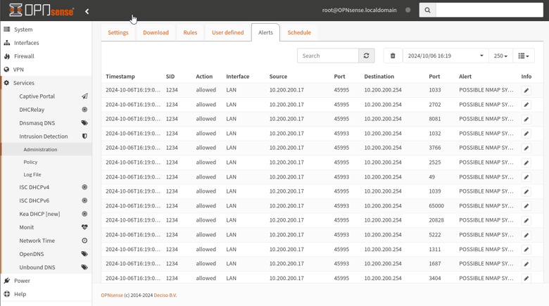

# OPNsense Firewall & IDS/IPS | Network Security Lab


## Objective

The objective of this project was to design, deploy, and validate a virtualized network security environment using **OPNsense**, **Suricata**, and **Squid Proxy**.

The lab focused on firewall administration, intrusion detection, network traffic monitoring, web filtering, and SSL inspection.

Kali Linux was used to generate controlled security testing traffic, while Windows 10 served as the protected client endpoint.

**Project Type:** Independent Cybersecurity Lab  
**Completed By:** Alexander Cox  
**Environment:** VMware Workstation Pro

---

## Skills Learned

- Deployment and administration of OPNsense firewalls.
- Configuration of WAN/LAN interfaces and firewall policies.
- Network intrusion detection using Suricata.
- Development and deployment of custom Suricata signatures.
- Network reconnaissance testing using Nmap.
- Investigation and analysis of security alerts.
- Squid Proxy configuration and URL filtering.
- SSL certificate management and trusted root configuration.
- Network troubleshooting and connectivity validation.
- Implementation and testing of layered network security controls.

## Tools Used

| Tool | Purpose |
|---|---|
| OPNsense | Firewall, routing, and network security |
| Suricata | Intrusion detection and prevention |
| Squid Proxy | Web filtering and proxy management |
| VMware Workstation Pro | Virtual lab infrastructure |
| Kali Linux | Security testing and reconnaissance |
| Windows 10 | Protected client endpoint |
| Nmap | Network scanning and IDS validation |
| FileZilla | Custom ruleset file transfer |
| Python HTTP Server | Hosting custom Suricata rules |
| OpenSSL | Certificate conversion |

---

## Lab Environment

The virtualized network consisted of an OPNsense firewall, a Kali Linux testing workstation, and a Windows 10 client.

```text
                    External Network
                           |
                           |
                    OPNsense Firewall
                    WAN: em0 | LAN: em1
                       10.200.200.254
                           |
                    10.200.200.0/24
                           |
              +------------+------------+
              |                         |
          Kali Linux                Windows 10
         10.200.200.17             10.200.200.16
              |                         |
       Security Testing           Protected Client
```

### Network Configuration

| Device | IP Address | Role |
|---|---|---|
| OPNsense | 10.200.200.254 | Firewall / Gateway |
| Kali Linux | 10.200.200.17 | Security Testing |
| Windows 10 | 10.200.200.16 | Protected Endpoint |
| Internal Network | 10.200.200.0/24 | Lab Subnet |

---

## Steps

### 1. Virtual Lab Deployment

The project began with the deployment of OPNsense, Kali Linux, and Windows 10 virtual machines using VMware Workstation Pro.

OPNsense was configured as a FreeBSD-based virtual machine with 2 GB RAM and 2 CPU cores.

Kali Linux was allocated at least 4 GB RAM and 2 CPU cores to support security testing.

The virtual machines were connected through an isolated virtual network for controlled experimentation.


*Ref 1: VMware Workstation showing the virtual lab environment.*


*Ref 2: OPNsense virtual machine hardware configuration.*

### 2. OPNsense Network Configuration

OPNsense was configured with separate WAN and LAN interfaces.

The WAN interface was assigned to `em0`, while the LAN interface was assigned to `em1`.

The LAN gateway was configured as:

```text
IP Address: 10.200.200.254
Subnet Mask: 255.255.255.0
Network: 10.200.200.0/24
```

This allowed OPNsense to serve as the gateway for the internal lab network.


*Ref 3: OPNsense WAN and LAN interface assignments.*


*Ref 4: OPNsense management dashboard after initial configuration.*

### 3. Kali Linux and Windows Client Configuration

Kali Linux was configured with a static IP address to communicate with OPNsense.

The network configuration was modified using:

```bash
sudo nano /etc/network/interfaces
```

The Kali Linux interface was configured with:

```text
auto eth1
iface eth1 inet static
    address 10.200.200.17
    netmask 255.255.255.0
    gateway 10.200.200.254
```

Connectivity was tested using:

```bash
ping 10.200.200.254
```

Windows 10 was configured with the following settings:

```text
IP Address: 10.200.200.16
Subnet Mask: 255.255.255.0
Default Gateway: 10.200.200.254
```


*Ref 5: Kali Linux static IP address configuration.*



*Ref 6: Connectivity validation between Kali Linux and OPNsense.*



*Ref 7: Windows 10 network configuration.*

### 4. Suricata IDS/IPS Configuration

Suricata was enabled within OPNsense to monitor network traffic and detect suspicious activity.

The intrusion detection configuration included:

- Enabling Suricata.
- Selecting the appropriate monitoring interface.
- Configuring the internal network.
- Enabling promiscuous mode.
- Activating detection rules.
- Configuring intrusion prevention settings.

The internal network was defined as:

```text
10.200.200.0/24
```



*Ref 8: Suricata intrusion detection and prevention configuration.*

### 5. Custom Suricata Rule Deployment

Custom Suricata rules were prepared to detect suspicious network reconnaissance activity.

The configuration included a custom rules file and corresponding XML ruleset metadata.

These files were transferred using FileZilla and hosted through a Python HTTP server running on Kali Linux.

The HTTP server was started using:

```bash
sudo python3 -m http.server 80
```

The files were made accessible through:

```text
http://10.200.200.17/
```

OPNsense was configured to retrieve and activate the custom ruleset.



*Ref 9: Custom Suricata signature for detecting reconnaissance activity.*



*Ref 10: XML metadata used to register the custom ruleset.*


*Ref 11: FileZilla used to transfer custom rule files.*


*Ref 12: Python HTTP server hosting the custom Suricata rules.*


*Ref 13: OPNsense configuration for retrieving the custom ruleset.*

### 6. Nmap Intrusion Detection Testing

A controlled Nmap SYN scan was executed from Kali Linux against the OPNsense firewall.

The following command was used:

```bash
sudo nmap -sS -Pn --top-ports 500 10.200.200.254
```

The scan simulated network reconnaissance activity within the isolated lab.

| Parameter | Description |
|---|---|
| `-sS` | TCP SYN scan |
| `-Pn` | Skip host discovery |
| `--top-ports 500` | Scan 500 common ports |
| `10.200.200.254` | Target firewall |



*Ref 14: Kali Linux executing an Nmap SYN scan against OPNsense.*

### 7. Suricata Alert Analysis

After the Nmap scan, Suricata alerts were reviewed to determine whether the custom detection rules identified the activity.

The detection workflow generated alerts associated with a possible Nmap SYN stealth scan.

During testing, detection thresholds and rule configurations were adjusted to improve alert visibility.



*Ref 15: Suricata security alerts generated during Nmap reconnaissance testing.*

**Result:** The custom detection workflow successfully generated alerts for the simulated scan. Alert generation confirms detection, not necessarily that the traffic was blocked.

### 8. SSL Certificate Configuration

A certificate was generated through OPNsense to support SSL inspection testing.

The exported certificate required conversion from `.p12` to `.crt` format for installation on the Windows client.

The certificate was imported into the Windows Trusted Root Certification Authorities store.

This established certificate trust for the controlled proxy inspection environment.


*Ref 16: Certificate configuration within OPNsense.*


*Ref 17: Certificate import into the Windows trusted root store.*

### 9. Squid Proxy Configuration

Squid Proxy was installed and configured within OPNsense to provide centralized web filtering and access control.

The proxy configuration included:

- Enabling the Squid service.
- Configuring proxy interfaces.
- Applying access control policies.
- Configuring HTTP and HTTPS proxy handling.
- Implementing traffic redirection.
- Testing proxy connectivity.

The documented proxy forwarding design included:

```text
HTTP Proxy Port: 3128
HTTPS Proxy Port: 3129
```


*Ref 18: Squid Proxy configuration in OPNsense.*


*Ref 19: NAT port forwarding configuration for proxy traffic.*

### 10. Web Filtering and Firewall Access Controls

URL blacklists were configured to restrict access to selected websites.

Firewall rules were also configured to manage network traffic and reduce the ability of clients to bypass proxy controls.

The Windows 10 virtual machine was used to validate the configured restrictions.


*Ref 20: Squid Proxy blacklist and access control configuration.*


*Ref 21: OPNsense LAN firewall rule configuration.*


*Ref 22: Firewall policies controlling traffic on the internal network.*

### 11. Web Filtering Validation

The Windows 10 client was used to attempt access to a restricted website.

Squid Proxy returned an **Access Denied** response, confirming that the configured web filtering policy was applied.


*Ref 23: Squid Proxy denying access to a restricted website.*

---

## Results

The project demonstrated the implementation of multiple defensive security controls within a virtualized network environment.

| Security Control | Result |
|---|---|
| OPNsense Firewall | Deployed as the internal network gateway |
| Network Configuration | Configured communication between lab systems |
| Suricata IDS | Detected simulated network reconnaissance |
| Custom Detection Rules | Generated alerts for controlled Nmap activity |
| Squid Proxy | Configured centralized web filtering |
| URL Blacklists | Restricted access to selected websites |
| SSL Certificate Trust | Configured for proxy inspection testing |
| Firewall Policies | Implemented network access controls |

### Key Findings

- Custom Suricata signatures can identify suspicious reconnaissance activity when correctly deployed and tested.
- Detection thresholds and rule configurations affect the visibility of security events.
- Proxy-based filtering can enforce restrictions on client web access.
- Correct network addressing and gateway configuration are essential for reliable communication.
- Certificate management is an important component of encrypted traffic inspection.
- Combining firewall rules, intrusion detection, and proxy filtering provides layered network defense.

---

## Challenges and Resolutions

| Challenge | Resolution |
|---|---|
| Kali Linux connectivity issues | Configured a static IP address on the correct interface |
| Windows network connectivity | Corrected network and gateway settings |
| Custom Suricata rules not loading | Adjusted ruleset configuration and deployment |
| Nmap alerts not appearing consistently | Tuned detection rules and thresholds |
| Proxy blacklist update failures | Used a compatible blacklist source |
| Certificate trust errors | Converted and imported the certificate |
| Proxy connection issues | Corrected proxy protocol configuration |
| OPNsense update failures | Adjusted IPv6 settings during troubleshooting |

---

## Conclusion

This independent cybersecurity lab provided hands-on experience in implementing a layered network security environment using OPNsense, Suricata, and Squid Proxy.

The project strengthened my understanding of firewall administration, intrusion detection, custom security rules, network reconnaissance, web filtering, SSL certificate management, and troubleshooting.

By deploying and testing these technologies in a controlled environment, I developed practical skills relevant to Security Operations, Network Security, and defensive cybersecurity engineering.

---

## References

- [OPNsense Documentation](https://docs.opnsense.org/)
- [Suricata Documentation](https://docs.suricata.io/)
- [Squid Proxy Documentation](https://www.squid-cache.org/Doc/)
- [Nmap Reference Guide](https://nmap.org/book/man.html)
- [OpenSSL Documentation](https://docs.openssl.org/)
