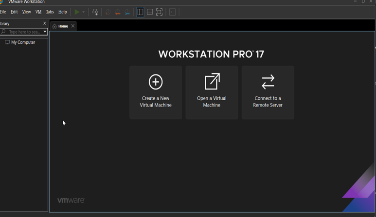
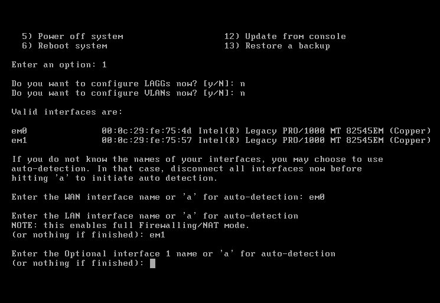
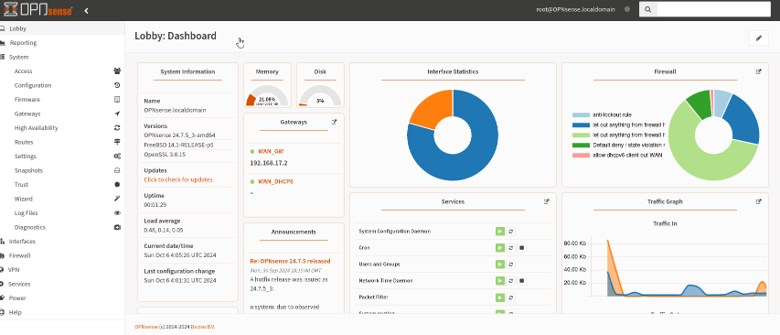
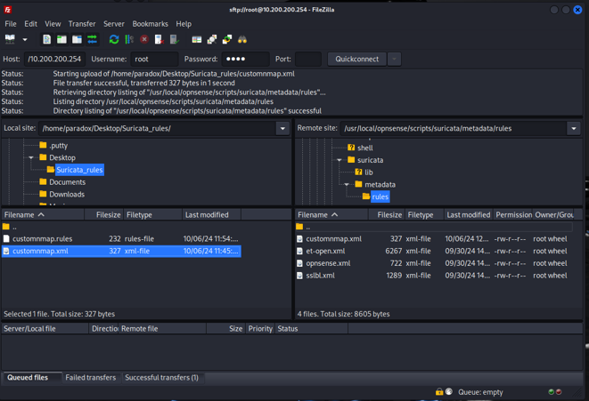
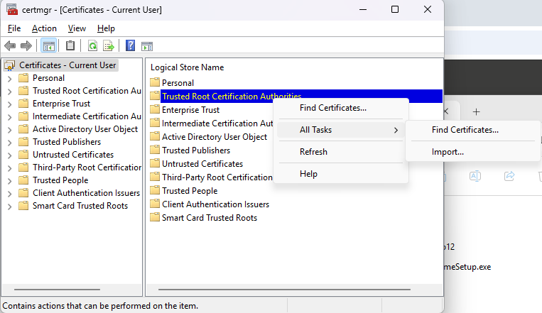
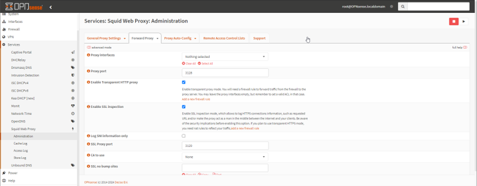
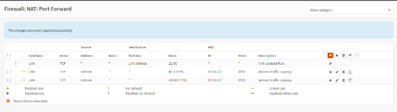
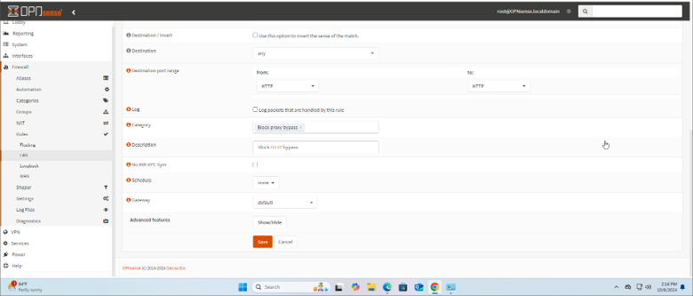
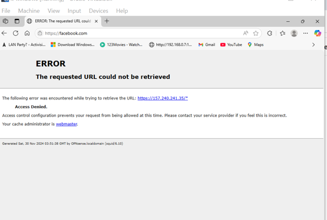

# OPNsense Firewall, Suricata IDS/IPS & Squid Proxy Lab

   

## Objective

Independently build and validate a virtualized defensive network lab using **OPNsense** for routing and firewall policy, **Suricata** for intrusion detection, and **Squid** for proxy-based web access controls. I used Kali Linux to generate controlled test traffic and Windows 10 as a client endpoint.

**Project:** Independent cybersecurity lab  
**Completed by:** Alexander Cox  
**Environment:** VMware Workstation Pro 17  
**Lab period:** October–November 2024

## Skills demonstrated

- Virtual network deployment and TCP/IP troubleshooting
- OPNsense interface, NAT and firewall rule configuration
- Suricata IDS/IPS setup and custom rule authoring
- Controlled Nmap reconnaissance and security-alert analysis
- Squid proxy, remote blacklist and web filtering setup
- Certificate handling for SSL inspection configuration

## Tools

| Tool | Role |
| --- | --- |
| OPNsense | Gateway, firewall, NAT and security services |
| Suricata | IDS/IPS and custom signature detection |
| Squid (`os-squid`) | Web proxy and access control |
| VMware Workstation Pro 17 | Virtualization |
| Kali Linux, Nmap | Controlled reconnaissance testing |
| Windows 10 | Protected test client |
| FileZilla, Python HTTP server | Custom ruleset distribution |

## Lab topology

```text
                  External / WAN network
                            |
                   OPNsense firewall
                    WAN em0 / LAN em1
                      10.200.200.254
                            |
                    10.200.200.0/24
                      /           \
             Kali Linux         Windows 10
             10.200.200.17      10.200.200.16
             Nmap / rules       Test browser
```

> **Scope:** All scan and access-control testing was conducted against systems in my own virtual lab. Screenshots are presented as captured; results are not extrapolated beyond what they show.

## Implementation and evidence

### 1. Virtual machine preparation

I prepared a VMware Workstation Pro 17 environment for OPNsense, Kali Linux and Windows 10. OPNsense was installed as a FreeBSD 14 (64-bit) guest. The screenshots below document the setup process rather than claiming that a single image shows every running VM.



*Figure 1: VMware Workstation Pro 17 launch screen.*


*Figure 4: FreeBSD 14 guest OS selection for OPNsense.*


*Figure 7: OPNsense boot menu.*

### 2. OPNsense interface assignment and dashboard

I assigned **WAN to `em0`** and **LAN to `em1`**, then accessed the OPNsense management interface at `10.200.200.254`.



*Figure 8: OPNsense WAN and LAN interface assignment.*



*Figure 14: OPNsense dashboard after setup.*

### 3. Client network configuration and connectivity

The isolated lab used the `10.200.200.0/24` subnet. Kali Linux used `10.200.200.17`, Windows 10 used `10.200.200.16`, and OPNsense was reachable at `10.200.200.254`. The Kali configuration screenshot shows the address and netmask; the gateway is confirmed separately by the client configuration and connectivity testing, not shown in that particular editor screenshot.

```text
OPNsense LAN: 10.200.200.254
Kali eth1:    10.200.200.17/24
Windows 10:   10.200.200.16/24
```


*Figure 9: Kali `/etc/network/interfaces` static address configuration.*


*Figure 12: Kali `ifconfig` output and successful gateway ping.*


*Figure 28: Windows `ipconfig` showing static IPv4 settings.*

### 4. Suricata intrusion detection and prevention

I enabled Suricata and IPS mode through OPNsense. The settings screenshot also shows promiscuous mode enabled.


*Figure 15: Suricata enabled with IPS and promiscuous modes.*

### 5. Custom Suricata rule and distribution

I authored a custom SYN-scan detection signature and its XML ruleset definition. The signature uses SID **1234** and a threshold keyed by source. I transferred the files via FileZilla and hosted the rules directory using a Python HTTP server on port 80 so OPNsense could retrieve the custom ruleset.

```bash
sudo python3 -m http.server 80
```

The ruleset XML points to `http://10.200.200.17/` and the custom rule file shown in the screenshots.


*Figure 17: Custom Suricata SYN-scan detection rule.*


*Figure 18: Custom XML ruleset configuration.*



*Figure 19: FileZilla transfer of custom ruleset files.*


*Figure 20: Python HTTP server hosting custom rules.*


*Figure 21: OPNsense custom ruleset download entry.*

### 6. Reconnaissance test and Suricata alerts

From Kali Linux, I performed an authorized SYN scan of the OPNsense lab gateway:

```bash
sudo nmap -sS -Pn --top-ports 500 10.200.200.254
```

The scan output shows open ports **22/tcp**, **53/tcp**, and **80/tcp**. Suricata subsequently recorded multiple alerts associated with the custom rule (SID 1234). **The alert table labels the action `allowed`; this is evidence of detection, not proof that the scan was blocked.**


*Figure 22: Nmap SYN scan and resulting open ports.*


*Figure 23: Suricata alerts triggered by the test scan.*

### 7. Certificate preparation for SSL inspection

I configured certificate parameters in OPNsense, exported a `.p12` certificate file, and opened Windows Certificate Manager to import the certificate into the Trusted Root Certification Authorities store. The screenshots document the import workflow; they do not independently demonstrate successful inspection of decrypted HTTPS traffic.


*Figure 24: OPNsense certificate configuration fields.*


*Figure 26: Exported `.p12` certificate file.*



*Figure 27: Windows Certificate Manager import workflow.*

### 8. Squid proxy configuration and NAT

I installed the `os-squid` plugin and configured Squid's transparent HTTP proxy and SSL inspection options. The proxy settings show **3128** for HTTP and **3129** for SSL. OPNsense NAT port-forward rules were used to redirect web traffic toward the proxy.


*Figure 30: OPNsense `os-squid` package.*



*Figure 31: Squid transparent proxy and SSL proxy settings.*



*Figure 32: OPNsense NAT port-forward rules for proxy.*

### 9. Blacklist and firewall enforcement

I configured a Squid remote blacklist source and LAN firewall rules designed to limit direct web traffic and reduce proxy bypass. The remote blacklist source was documented separately.


*Figure 33: Squid remote blacklist configuration.*


*Figure 35: LAN firewall block rule configuration.*



*Figure 36: LAN firewall rule destination and category settings.*


*Figure 37: Configured OPNsense LAN firewall rules.*

### 10. Web access validation

A Windows client browser displayed a Squid-generated **Access Denied** page when attempting to reach a restricted URL. This is direct evidence that a proxy access-control policy denied the request in this test.



*Figure 38: Squid Access Denied browser result.*

## Results

| Test | Observed evidence |
| --- | --- |
| OPNsense deployment | Web dashboard and assigned WAN/LAN interfaces |
| Internal connectivity | Kali ping replies from `10.200.200.254`; Windows IPv4 configuration |
| Custom Suricata detection | SID 1234 alerts after controlled Nmap SYN scan |
| Scan visibility | Nmap output showed ports 22, 53 and 80 open on lab gateway |
| Proxy enforcement | Squid `Access Denied` page in Windows browser |
| Certificate handling | Certificate export and Windows import workflow documented |

**Detection versus prevention:** Suricata's captured alert actions show `allowed`, so the demonstrated result is successful alert generation, not confirmed IPS blocking. The proxy denial screenshot independently demonstrates a web access-control decision.

## Troubleshooting and lessons learned

- Correct virtual adapter and static IP configuration were essential for reliable host-to-gateway connectivity.
- Custom Suricata rules required matching XML metadata, accessible hosted files and correct rule enablement.
- Scan signatures and thresholds influenced which traffic produced alerts.
- Squid filtering relied on coordinated proxy, NAT, blacklist and LAN firewall policies.
- Certificate export and client trust configuration are necessary steps when preparing an SSL-inspecting proxy.

## Screenshot inventory

All images are stored in [`images/`](images/). The README uses **27 selected screenshots** that document the core deployment, detection and web filtering results. The folder also includes setup and supporting screenshots not embedded in the main narrative. See [`SCREENSHOT-GUIDE.md`](SCREENSHOT-GUIDE.md) for the exact mapping from the original `Picture1.png`–`Picture38.png` files.

## References

- [OPNsense documentation](https://docs.opnsense.org/)
- [Suricata documentation](https://docs.suricata.io/)
- [Squid documentation](https://www.squid-cache.org/Doc/)
- [Nmap reference guide](https://nmap.org/book/man.html)
